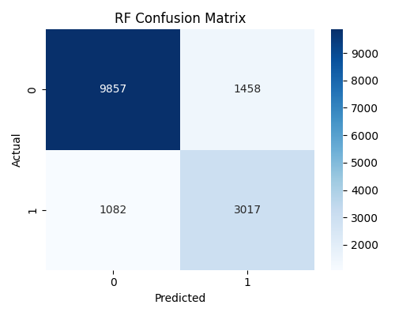
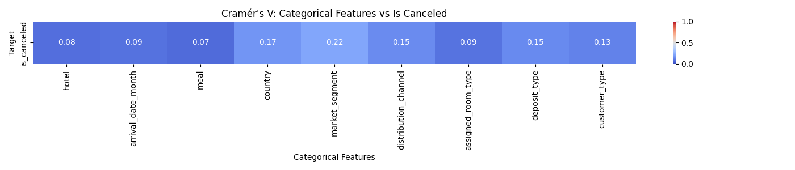

# Hotel Booking Cancellation Prediction

Predicts whether a hotel booking will be canceled, and compares four tuned machine learning models. Built as a course project for the AI Engineering & Machine Learning course at JET Academy.

## Results

Scores are for the test set of 15,414 bookings. About 27% of bookings in the cleaned data were canceled.

| Model | ROC-AUC | F1 | Recall | Precision | Accuracy |
|---|---|---|---|---|---|
| Random Forest | 0.900 | 0.704 | 0.736 | 0.674 | 0.835 |
| SVM (RBF kernel) | 0.890 | 0.688 | 0.823 | 0.592 | 0.802 |
| Decision Tree | 0.865 | 0.648 | 0.811 | 0.540 | 0.766 |
| KNN | 0.856 | 0.606 | 0.528 | 0.710 | 0.817 |

Random Forest gave the best balance. It found 3,017 of the 4,099 canceled bookings and wrongly flagged 1,458 bookings that were kept. SVM found the most cancellations, and KNN raised the fewest false alarms but missed about half of the cancellations.



## Data

This project uses the Hotel Booking Demand dataset, which has 119,390 bookings. It is not included in this repository.

1. Download it from [Kaggle](https://www.kaggle.com/datasets/jessemostipak/hotel-booking-demand).
2. Save it as `data/hotel_bookings.csv`.

## Method

### Cleaning

- Removed `reservation_status` and `reservation_status_date`, because they reveal the outcome.
- Removed `reserved_room_type`, `arrival_date_week_number`, `arrival_date_day_of_month` and `days_in_waiting_list` after analysis.
- Removed duplicates, which left 86,947 rows.
- Removed outliers with the IQR rule on lead time, stay length, average daily rate and special requests, which left 77,069 rows.

### Feature analysis

- A correlation matrix for numeric features.
- Cramér's V for categorical features.



### Modeling

- Stratified 80/20 train and test split.
- scikit-learn pipelines with `ColumnTransformer`, imputation, one-hot encoding, and scaling for KNN and SVM.
- `RandomizedSearchCV` with 3-fold stratified cross-validation, optimizing ROC-AUC.
- Balanced class weights for SVM, Decision Tree and Random Forest.

## Limitations

- Outliers were removed before the train and test split, so the scores describe typical bookings only. Unusual bookings, such as ones made very far in advance, are not in the test set.
- Removing `assigned_room_type` and `booking_changes`, which can change after a booking is made, lowered Random Forest ROC-AUC only slightly, from 0.900 to 0.895.

## How to run

```bash
pip install -r requirements.txt
python main.py
```

The full script can take over 30 minutes, because SVM is slow on this much data. Graphs are saved in `results/graphs/`.

## Project structure

```text
├── data/            Dataset goes here
├── results/graphs/  Saved graphs
├── main.py          Full analysis and training
└── requirements.txt
```

## Author

Murad Shikhmuradov
